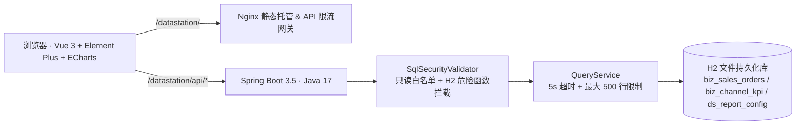

# 数据驿站 Lite（DataStation Lite）

[](https://github.com/calmjade/datastation-lite/actions/workflows/ci.yml)


**配置化低代码报表与 BI 看板平台** — 支持只读 SQL 探索、字段格式化配置、ECharts 多图表联动与驾驶舱发布。

- 🌐 **在线体验**：[https://calmjade.cn/datastation/](https://calmjade.cn/datastation/)
- 🏠 **作者作品集**：[https://calmjade.cn](https://calmjade.cn)

---

## 系统架构



---

## 核心特性

- **驾驶舱门户（BI Portal）**：顶部经营 KPI 概览卡片、ECharts 图表网格（`bar` / `line` / `pie` / `radar`）、明细表格切换与 UTF-8 BOM CSV 导出。
- **低代码报表设计器（Report Studio）**：左侧表结构浏览器、`Ctrl+Enter` 只读 SQL 编辑器、右侧字段别名/金额/百分比/标签格式化器与实时预览发布。
- **数据源与表字典（Dataset Explorer）**：自动探测 H2 表元数据与示例值，一键生成 `SELECT` 语句跳转设计器。
- **纵深 SQL 安全沙箱（P0 加固）**：
  - 严格限制单条 `SELECT` / `WITH` 语句（支持多行 SQL），拦截多语句 `;` 注入、DML/DDL 关键字。
  - 保留双引号/反引号标识符内容，防止 `"FILE_READ"('/etc/passwd')` 绕过；拦截 `FILE_READ`、`CSVREAD`、`LINK_SCHEMA`、`INFORMATION_SCHEMA` 等危险内置函数与系统目录。
  - JDBC 强制 `setQueryTimeout(5)` 与 `setMaxRows(500)`，配套 JUnit 5 安全测试套件（`SqlSecurityValidatorTest`）。

---

## 技术栈与端口约定

| 模块 | 技术栈 | 默认端口 |
| --- | --- | --- |
| 后端服务 (`backend/`) | Java 17 + Spring Boot 3.5.3 + Spring Data JPA + JDBC + H2 (MySQL Mode) | `8091` |
| 前端应用 (`frontend/`) | Vue 3.5 + TypeScript + Vite 6 + Element Plus + ECharts + Pinia | `9021` |

---

## 快速启动与测试

```powershell
# 1. 运行后端单测（JUnit 5）并启动后端（自动配置 JDK 21/17 与 Maven）
mvn -f backend/pom.xml test
.\start-backend.ps1

# 2. 启动前端应用（端口 9021）
cd frontend && pnpm install && pnpm dev
```

---

## 作者与许可

- **作者**：曹杰 / caojie (`calmjade`) · calmjade@foxmail.com
- **开源协议**：[MIT License](./LICENSE)
